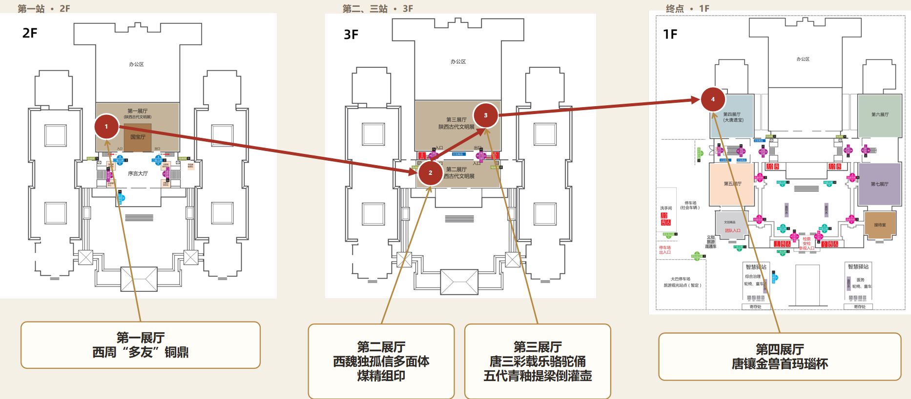
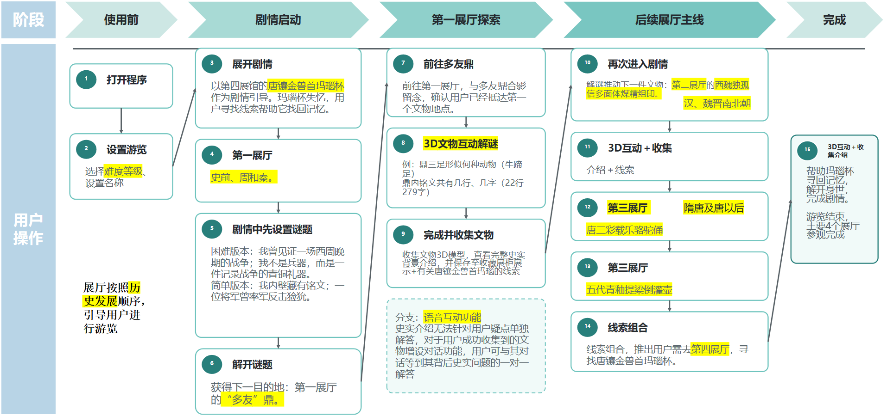

# Quest of the Living Town: A Gamified Travel Experience for Heritage Exploration

**中文名称：鲜活古城之旅：面向文化遗产探索的游戏化旅行体验**

## Project Overview | 项目概述

This project explores how gamified travel can transform heritage tourism from passive sightseeing into active cultural exploration. It will develop a mobile prototype that combines a continuous storyline, an anthropomorphic cultural-relic character, observation-based puzzles, interactive 3D models, collectible memories, cultural interpretation, and real-time voice communication. The evaluation will examine visitors’ exploration behaviour, motivation, emotional resonance, and cultural understanding.

本项目探索如何通过游戏化旅行，将文化遗产旅游从被动观光转变为主动的文化探索。项目计划开发一个移动端原型，将连续剧情、拟人化文物角色、基于观察的谜题、可交互3D模型、记忆收集、文化解读和实时语音交流结合起来，并评估其对游客探索行为、参与动机、情感共鸣和文化理解的影响。

## Target Users | 目标用户

- **Young visitors | 年轻游客：** 希望参观过程有趣、有参与感，同时愿意获得文化体验。
- **Study-tour groups | 研学旅行团体：** 带着学习目标参观，需要在有限时间内理解并记住文化知识。

## Design Context | 设计场景

The current case study focuses on the **Shaanxi History Museum in Xi’an**. The mobile experience follows the chronological exhibition route from the first exhibition hall to the fourth exhibition hall. A personified **Tang Dynasty Gilded Animal-Head Agate Cup** acts as the central NPC and asks the visitor to recover its lost memories and identity. Each puzzle directs the visitor to a representative artifact in the next stage of the route.

当前案例聚焦于**西安陕西历史博物馆**。移动端体验按照历史发展顺序，引导游客依次探索第一至第四展厅。拟人化的**唐镶金兽首玛瑙杯**作为贯穿故事的核心NPC，请求游客帮助它寻找遗失的记忆和身份。每一阶段的谜题都会指向下一件代表性文物，并推动参观路线和剧情继续发展。

### Proposed Museum Route | 计划参观路线

1. **First Exhibition Hall | 第一展厅**  
   **Western Zhou “Duo You” Bronze Ding | 西周“多友”铜鼎**  
   The visitor observes the vessel and its inscription, completes an interactive puzzle, and obtains the first clue.

2. **Second Exhibition Hall | 第二展厅**  
   **Western Wei Dugu Xin Polyhedral Coal-Jade Seal | 西魏独孤信多面体煤精组印**  
   The visitor rotates the multi-faced seal, examines its inscriptions, and matches different seals with their administrative uses.

3. **Third Exhibition Hall | 第三展厅**  
   **Tang Tri-coloured Camel with Musicians | 唐三彩载乐骆驼俑**  
   The artifact introduces Chang’an’s international cultural exchange and provides a clue about the western origin of the agate cup’s rhyton form.  
   **Five Dynasties Celadon Ewer with a Phoenix-shaped Handle and Inverted Filling Structure | 五代青釉提梁倒灌壶**  
   The visitor explores the vessel’s unusual filling structure and animal-shaped spout through a 3D interaction puzzle.

4. **Fourth Exhibition Hall | 第四展厅**  
   **Tang Dynasty Gilded Animal-Head Agate Cup | 唐镶金兽首玛瑙杯**  
   The visitor combines the collected clues, finds the physical artifact, helps the NPC recover its identity, and completes the main storyline.

## User Journey | 用户使用流程

The user opens the application, selects a puzzle difficulty, and meets the personified agate-cup NPC. The story provides a clue leading to the first exhibition hall. At each target artifact, the visitor completes an on-site observation task, interacts with a 3D model, unlocks cultural interpretation, and collects an artifact and a memory fragment. The next clue then guides the visitor to the following exhibition hall. A real-time voice interaction branch allows the visitor to ask the artifact character questions about its historical context.

用户打开程序、选择谜题难度，并与拟人化的玛瑙杯NPC相遇。剧情首先给出通往第一展厅的线索。游客在每件目标文物前完成现场观察任务，与3D模型互动，解锁文化介绍，并收集文物模型和记忆碎片。之后，下一条线索会继续引导游客前往后续展厅。实时语音互动分支允许游客向文物角色询问相关历史问题。

## Main Features | 主要功能

### 1. Continuous story across exhibition halls | 跨展厅连续剧情

One central story connects the four exhibition halls in chronological order. The result of each puzzle reveals the next artifact and advances both the physical route and the storyline.

以一条完整主线按历史顺序连接四个展厅。每道谜题的结果都会揭示下一件文物，同时推进现实参观路线和剧情。

### 2. Personified central artifact NPC | 拟人化核心文物NPC

The Tang Dynasty Gilded Animal-Head Agate Cup becomes a story character with dialogue, emotion, and a goal. The visitor helps it recover its identity by collecting evidence from other artifacts.

唐镶金兽首玛瑙杯被塑造成具有对话、情感和目标的故事角色。游客通过其他文物收集证据，帮助它找回身份和记忆。

### 3. Visitor role-playing | 游客参与角色扮演

The visitor becomes an investigator and companion in the story rather than only receiving explanations. Dialogue choices, exploration, observation, and puzzle solving move the story forward.

游客不再只是接受讲解，而是成为故事中的调查者和同行者，通过对话选择、探索、观察和解谜推动故事发展。

### 4. Observation-based puzzles connected to the route | 基于文物观察的路线谜题

The puzzles use observable details and historical information from the selected artifacts. Possible tasks include examining the *Duo You Ding* inscription, matching the faces of the Dugu Xin seal, identifying the musicians and instruments on the tri-coloured camel, and investigating the inverted-filling structure of the celadon ewer.

谜题使用目标文物可观察的细节及其历史信息，例如辨认多友鼎铭文、匹配独孤信组印的不同印面、识别三彩载乐骆驼俑上的乐手和乐器，以及探索倒灌壶的特殊注水结构。

### 5. Adaptive puzzle difficulty | 自适应谜题难度

Visitors can select a difficulty level. The system can provide progressive hints so that the tasks remain understandable without becoming too easy or frustrating.

游客可以选择谜题难度，系统通过逐级提示让任务保持可理解性，同时避免过于简单或产生挫败感。

### 6. Photo confirmation and collectible memories | 拍照确认与记忆收集

After reaching a target artifact, the visitor takes a photo to confirm the visit. Completing the task unlocks a digital memory fragment, historical interpretation, and the artifact’s 3D model.

游客到达目标文物后拍照确认。完成任务后，系统解锁数字记忆碎片、历史解读和相应的3D文物模型。

### 7. Interactive 3D artifact models | 可交互3D文物模型

The 3D models will support selection, translation, rotation, zooming, and detail inspection. These actions form part of the puzzles rather than serving only as visual decoration.

3D模型支持选择、平移、旋转、缩放和细节观察。这些操作会直接参与解谜，而不只是作为视觉展示。

- **Translation | 平移：** The user keeps one finger on the screen and drags. The model follows the finger and stops when the finger leaves the screen.  
  用户持续用单指接触屏幕并拖动，模型跟随手指轨迹移动；手指离开屏幕后停止移动。
- **Rotation | 旋转：** The model’s rotation speed and angle respond to the speed and distance of the drag gesture.  
  模型旋转的速度和角度由手指拖动的速度和幅度决定。
- **Zoom | 缩放：** Two-finger gestures control model size. The amount of zoom depends on the distance between the two fingers. Following the cited interface design, separating the fingers zooms out and bringing them together zooms in.  
  双指操作控制模型大小，缩放幅度取决于两指间距。按照参考文献中的操作映射，两指分开执行缩小，两指合拢执行放大。

### 8. Cultural interpretation unlocked through exploration | 探索后解锁文化解读

Historical information appears after the visitor reaches the artifact and completes its task. Cultural knowledge therefore becomes a reward for active observation and exploration.

历史信息在游客到达文物并完成任务后解锁，使文化知识成为主动观察和探索的成果。

### 9. Real-time voice interaction with the artifact NPC | 与文物NPC实时语音互动

The proposed voice architecture uses OpenAI’s Realtime API with a persistent, bidirectional WebSocket connection for audio-to-audio communication. This reduces latency by removing the separate STT and TTS cycle and supports a conversation rhythm closer to face-to-face communication.

语音方案计划采用OpenAI实时API，通过持久化的双向流WebSocket进行音频到音频通信，省去独立的STT和TTS循环，降低实时交流延迟，使文物NPC与游客的对话更接近真实交流。

### 10. Main quest and optional voice-based exploration | 主线任务与可选语音探索

The main quest ends when the visitor completes the four-hall route and identifies the agate cup. Voice questions and additional artifact information remain optional so that they do not interrupt the main route.

游客完成四个展厅的路线并确认玛瑙杯身份后结束主线。语音提问和额外文物信息为可选内容，不会阻碍主线推进。

## Proposed Technical Approach | 计划采用的技术方案

The following technologies come from the reviewed implementation literature and form the current technical reference architecture. The final prototype may adjust versions or components after feasibility testing.

以下技术来自已阅读文献中的实现方案，构成当前的技术参考架构。最终原型会根据可行性测试调整具体版本或组件。

- **Unity 2020.3.33f1c2:** Mobile application and interactive 3D scene development | 移动端程序及3D交互场景开发。
- **Vuforia SDK 9.8.31:** 2D and 3D image-target recognition, markerless tracking, and multi-target tracking | 2D/3D图像目标识别、无标记跟踪和多目标跟踪。
- **iOS and Android compatibility:** Vuforia supports native development on both platforms and integrates with Unity | Vuforia兼容iOS与Android原生开发，并可与Unity集成。
- **Blender:** Construction or preparation of the cultural-relic 3D models | 构建或整理文物3D模型。
- **Procreate:** Creation of model textures where needed | 根据需要绘制模型纹理。
- **Mobile model optimisation:** Reduce mesh density and model complexity so the artifacts can run on lower-performance mobile devices | 降低网格密度与模型复杂度，使文物模型可在性能较低的移动设备上运行。
- **Image-target requirements:** Keep target images below 2 MB and aim for a Vuforia recognition rating of at least three stars | 图像目标控制在2MB以内，并争取达到Vuforia三星及以上识别评级。
- **Persistent bidirectional WebSocket:** Stream user and agent audio in both directions with reduced latency | 持续双向传输用户与智能体音频，降低交流延迟。
- **OpenAI Realtime API:** Direct audio-to-audio conversation for the anthropomorphic artifact NPC | 为拟人化文物NPC提供音频到音频的实时对话。

## Related Academic Literature | 相关学术文献

1. **Learning Curiosity through Play: Exploring the Role of Games and Interactive Design in Museums**  
   Supports game-based interaction, scaffolding, adaptive prompts, and curiosity in museum learning.  
   <https://doi.org/10.1145/3706598.3713164>

2. **The Collision of Tradition and Fashion: How Anthropomorphizing Museum Exhibits Influences Cultural Inheritance**  
   Supports artifact anthropomorphism, reduced psychological distance, active exploration, and cultural learning.  
   <https://www.sciencedirect.com/science/article/pii/S0261517725000032>

3. **Commodification of Photogenic Sites and Rise of “Selfie Parks” as Tourist Enclaves**  
   Discusses photography-oriented tourism and the risk of visitors engaging with destinations mainly as photographic backgrounds.  
   <https://doi.org/10.1080/14616688.2025.2532582>

4. **LLM-based Embodied Conversational Agent for Reducing Foreign Language Speaking Anxiety in Social VR**  
   Provides a reference for direct audio-to-audio communication through OpenAI’s Realtime API and a persistent bidirectional WebSocket session.  
   <https://dl.acm.org/doi/full/10.1145/3772318.3791068>

5. **ConversAR: Exploring Embodied LLM-Powered Group Conversations in Augmented Reality for Second Language Learners**  
   Provides an alternative STT/LLM/TTS conversational pipeline and discusses latency management in embodied AR conversations.  
   <https://dl.acm.org/doi/10.1145/3706599.3720162#sec-3>

6. **Design and Evaluation of Touch and Touchless Interfaces for Interactive Digital Heritage Experiences**  
   Supports Blender and Unity based 3D heritage development and touch operations including selection, translation, rotation, zoom-in, and zoom-out.  
   <https://www.nature.com/articles/s40494-025-01889-3>

7. **HeritageSite AR: Design and Evaluation of a Mobile Augmented Reality Exploration Game for a Chinese Heritage Site**  
   Provides a mobile AR implementation reference using Unity 2020.3.33f1c2 and Vuforia SDK 9.8.31, including model optimisation and image-target requirements.  
   <https://doi.org/10.1145/3700881>

## Project Materials | 项目资料

- [`FYP PPT1.pptx`](materials/FYP%20PPT1.pptx): presentation prepared for the first FYP group meeting | 第一次FYP组会演示文稿
- [`FYP PPT2.pptx`](materials/FYP%20PPT2.pptx): presentation prepared for the second FYP group meeting | 第二次FYP组会演示文稿
- [`FYP文献参考.xlsx`](materials/FYP文献参考.xlsx): updated literature links, analyses, implementation notes, and selected excerpts | 更新后的文献链接、分析、技术笔记与原文摘录
